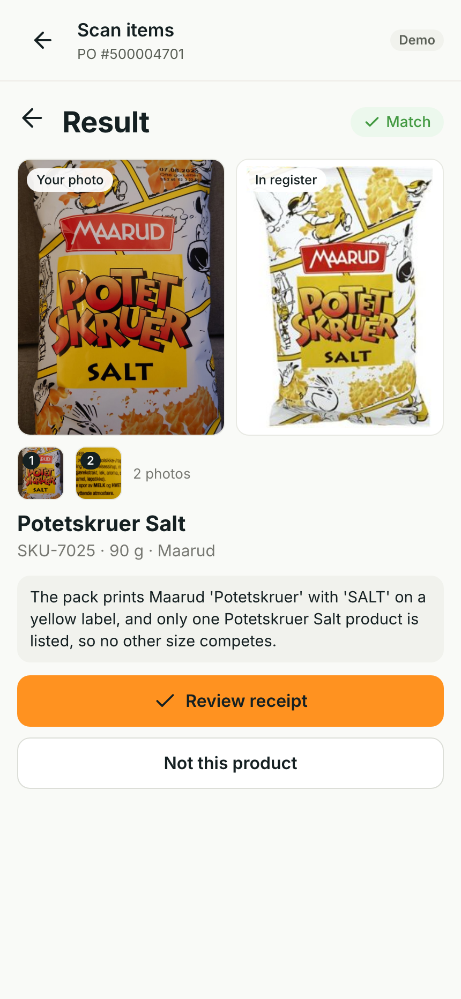

# Identify by photo for Holio Ops

When a warehouse item has no usable barcode, photograph it, review the suggested product, quantity and location, then receive it. Link an unknown barcode during review so the next unit scans normally.

Built for Holio's Oslo Sprint 2026 challenge, pain 3. This repository contains the React component, identification service, receiving demo and test evidence.

[Watch the 64-second demo](docs/demo/receiving.mp4) · [Try it step by step](docs/jury.md) · [Integration guide](docs/integration.md)

<a href="docs/demo/receiving.mp4"></a>

The recording uses two real fixture photos and a real Claude response. Barcode input uses the labeled Demo tools buttons. It is a browser recording, not a physical phone test.

## What works

- Known barcodes receive one unit and keep the scanner open, with an undo action.
- Unknown or missing barcodes offer photo identification and manual search.
- Identification compares the photos with the products on the purchase order. An uncertain answer offers candidates; errors retain manual search.
- Photo and manual selections open receipt review. Only **Receive** commits the quantity, location and optional extra barcode. Over-receipt needs a separate confirmation.
- Products outside the order cannot be received. A linked barcode receives the next unit without another model call.

The demo follows Holio Ops' visual design. Its counts and locations are page memory; extra barcodes are stored in this browser. It does not write to Holio stock. See the [receiving design](design/receiving-v2.html) and [component documentation](app/README.md).

## Measured evidence

| Check | Observed result | Evidence |
|---|---|---|
| Recorded product flow, 8 November | Correct SKU-7025, review, Receive, barcode link and next scan. One real call: 5.106 s server time, 5.111 s browser request time; no model/API failure | [Result and raw response](evidence/delivery-20261108/README.md) |
| Scheduled product check at 04:00 Oslo, 8 November | Same SKU and complete receiving flow; 7.893 s server time, about 8.4 s observed in the browser | [Saved result](evidence/delivery-20261108/scheduled-0400.json) |
| Simulated eight-item purchase orders, 7 November | 36/38 in-order items matched correctly; 0 wrong matches; 2 offered a choice containing the correct item. For 47 off-order cases: 45 rejected, 1 offered a choice, 1 wrong match | [Method, inputs and scores](evidence/po-context/README.md) |

These are grocery photos from a development dataset. The two product checks use the same known fixture, so they demonstrate the flow, not recognition accuracy on new warehouse photos. Technical failures and uncertain visual results are recorded separately. Arena experiments are not included in these app results.

## Run locally

Use macOS, Node/pnpm, uv and an existing Claude CLI login. The server uses Apple Vision for OCR, CLIP for retrieval and Claude Sonnet for the final suggestion.

```sh
git clone https://github.com/harepus/holio-photo-id.git
cd holio-photo-id
pnpm --dir app install --frozen-lockfile
pnpm --dir app build
HPI_HOST=127.0.0.1 HPI_PORT=8781 uv run server/app.py
```

Open `http://127.0.0.1:8781`. Wait for `/healthz` to report `clipWarm: true` and `indexedImages: 247` before identifying. First startup may download dependencies and model weights. Phone camera scanning needs HTTPS; the hosted demo has a separately shared access link. The [jury guide](docs/jury.md) includes fixture photos and recovery steps.

The `?mock=match` and other mock URLs label themselves **Mock** and exercise the interface only. They do not measure recognition.

## Holio integration

Mount `IdentifyByPhoto` at the unknown-barcode action, send the order's candidates to `POST /v1/identify`, then pass the confirmed SKU into Holio's receipt review. The [integration guide](docs/integration.md) lists the existing interfaces and the work needed for authenticated, durable stock writes.

The current service requires macOS and uses a Claude subscription through the CLI. The API-key path exists but has not been verified. Production hosting, real catalog quality, physical iPhone/Zebra behavior, case packs, durable storage and cross-device barcode linking remain integration work.

## Repository map

| Path | Contents |
|---|---|
| [app/](app/) | React component, receiving shell and browser checks |
| [server/](server/) | Endpoint, recognition engine and contract tests |
| [contract/identify.md](contract/identify.md) | Request, response and technical errors |
| [design/](design/) | Pain selection and screen/state designs |
| [evidence/](evidence/) | Measurements and recorded product verification |
| [demo/](demo/) | Simulated purchase order and 247-item register |

The [demo register](demo/register/register.json) attributes its product images to Open Food Facts (CC BY-SA). Barcode source links are stored in the [demo order](demo/purchase-order.json). No customer catalog or customer stock data is used.
